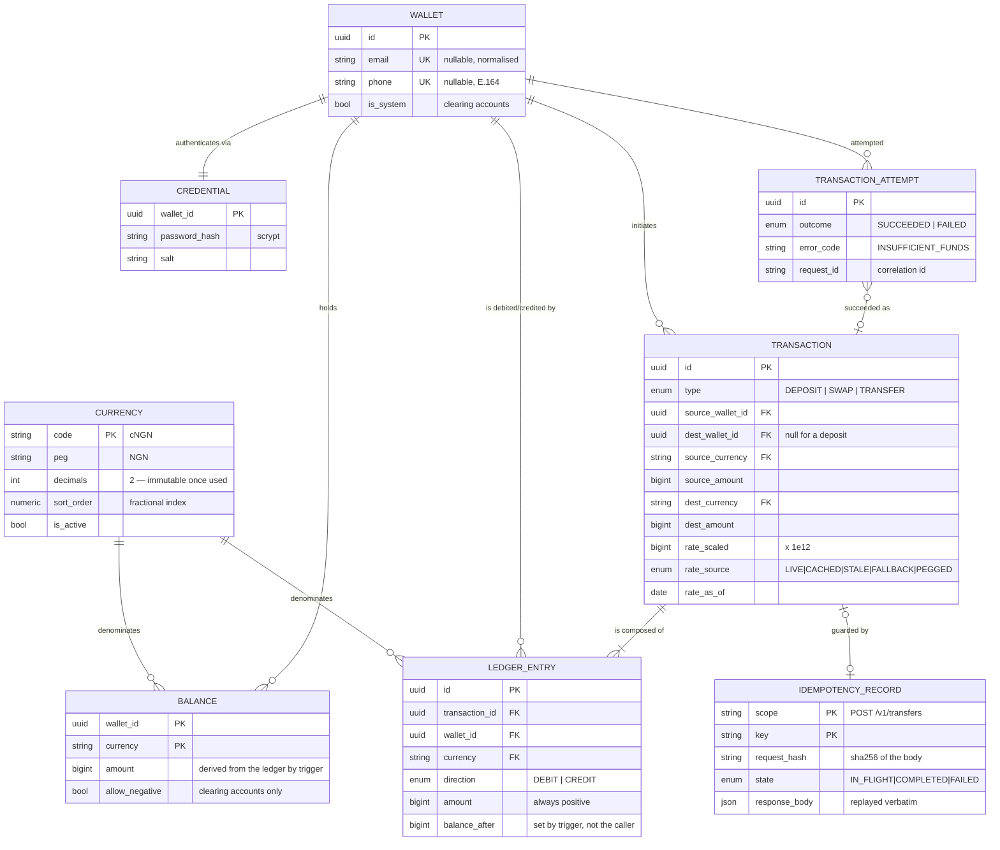

# Operation Borderless

A cross-border stablecoin payment sandbox. Multi-currency wallets, simulated
deposits, cross-currency swaps, wallet-to-wallet transfers, and an auditable
transaction history — built as a REST API with no frontend.

Five mock stablecoins, each pegged 1:1 to a fiat currency:

| Token | Peg | Decimals | Minor unit |
|---|---|---:|---|
| `cNGN` | NGN — Nigerian Naira | 2 | kobo |
| `cGHS` | GHS — Ghanaian Cedi | 2 | pesewa |
| `cXAF` | XAF — Central African CFA franc | **0** | franc |
| `USDx` | USD — US Dollar | 6 | micro-dollar |
| `EURx` | EUR — Euro | 6 | micro-euro |

`cXAF` has no decimals because the CFA franc has no subunit in circulation. That
is not a simplification — `"100.50"` cXAF is rejected rather than rounded.

```
226 tests  ·  TypeScript strict  ·  docker compose up
```

---

## Quick start

```bash
docker compose up --build
```

That is the whole thing. The API comes up on `http://localhost:3000`, migrations
and the currency seed run from the container's entrypoint, and Swagger UI is at
**http://localhost:3000/docs**.

If ports 5432 or 6379 are already taken on your machine:

```bash
POSTGRES_PORT=55432 REDIS_PORT=56380 docker compose up --build
```

### Running the tests

```bash
yarn test
```

No setup required — the suite starts throwaway PostgreSQL and Redis containers,
applies the committed migrations and seeds the currency table. Docker must be
running. To reuse containers you already have:

```bash
TEST_DATABASE_URL=postgresql://... TEST_REDIS_URL=redis://... yarn test
```

Both must point at **disposable** instances: the suite flushes the Redis
database and writes freely to the schema.

```bash
yarn test:unit   # fast, hermetic — no database, no network
yarn test:e2e    # the full application over HTTP
yarn lint && yarn typecheck && yarn docs:check
```

### Running locally without Docker

```bash
cp .env.example .env            # then point DATABASE_URL / REDIS_URL at your own
yarn install
yarn prisma:deploy && yarn db:seed
yarn start:dev
```

Yarn 4 is vendored in the repo via `.yarnrc.yml`'s `yarnPath`, so you do not
need to install or pin a package manager — any `yarn` on your PATH delegates to
the committed release, and `corepack enable` works too.

---

## Walkthrough

Amounts are **decimal strings**, never JSON numbers. `JSON.parse('{"amount":0.1}')`
already holds an IEEE-754 double before any server code runs.

### 1. Create a wallet

```bash
curl -X POST localhost:3000/v1/wallets \
  -H 'content-type: application/json' \
  -d '{"email":"ada@example.com","password":"correct-horse-battery-staple"}'
```

```json
{
  "id": "01a186de-ebf2-776d-855a-171636dc7355",
  "email": "ada@example.com",
  "phone": null,
  "balances": [
    { "currency": "cNGN", "amount": "0.00", "usdEquivalent": "0.000000" },
    { "currency": "cXAF", "amount": "0",    "usdEquivalent": "0.000000" }
  ],
  "totalUsdEquivalent": "0.000000",
  "totalCurrency": "USDx",
  "ratesAsOf": "2026-10-29T08:00:00.000Z",
  "ratesSource": "live",
  "tokens": {
    "walletId": "01a186de-ebf2-776d-855a-171636dc7355",
    "accessToken": "eyJhbGciOi...",
    "refreshToken": "eyJhbGciOi...",
    "expiresIn": 900,
    "tokenType": "Bearer"
  }
}
```

A wallet is identified by an email address **or** a mobile number in E.164
format. Exactly one is required and neither may already belong to another
wallet. Creation returns a token pair, so creating and first using a wallet is
one round trip — and `id` is what another wallet needs as `toWalletId` to send
you money.

### 2. Deposit (simulated)

```bash
curl -X POST localhost:3000/v1/deposits \
  -H "authorization: Bearer $ACCESS_TOKEN" \
  -H 'content-type: application/json' \
  -H 'idempotency-key: 7f9a2c54-1e3b-4d7a-9f10-2b5c8e4a6d31' \
  -d '{"currency":"cNGN","amount":"1500000.00"}'
```

```json
{
  "id": "01a186e1-3c21-7a0e-9f22-6b1d2e4a8c90",
  "type": "DEPOSIT",
  "direction": "CREDIT",
  "sourceCurrency": "cNGN", "sourceAmount": "1500000.00",
  "destCurrency": "cNGN",   "destAmount": "1500000.00",
  "rate": "1", "rateSource": "PEGGED",
  "rateAsOf": "2026-10-29T08:09:12.000Z",
  "createdAt": "2026-10-29T08:09:12.401Z"
}
```

### 3. Swap inside the wallet

```bash
curl -X POST localhost:3000/v1/swaps \
  -H "authorization: Bearer $ACCESS_TOKEN" \
  -H 'content-type: application/json' \
  -H 'idempotency-key: 3b1f8e22-54c9-4a07-bd61-9e4f2a7c1d85' \
  -d '{"fromCurrency":"cNGN","toCurrency":"USDx","amount":"500000.00"}'
```

```json
{
  "type": "SWAP",
  "sourceCurrency": "cNGN", "sourceAmount": "500000.00",
  "destCurrency": "USDx",   "destAmount": "371.405660",
  "rate": "0.00074281132", "rateSource": "LIVE"
}
```

### 4. Transfer, converting on the way

```bash
curl -X POST localhost:3000/v1/transfers \
  -H "authorization: Bearer $ACCESS_TOKEN" \
  -H 'content-type: application/json' \
  -H 'idempotency-key: 9c7d1b40-2a68-4f13-8e5a-6b0c3d9f7e12' \
  -d '{"toWalletId":"01a186df-7c10-7bb1-9a44-2f8e1c3d5a67",
       "currency":"USDx","toCurrency":"EURx","amount":"100.000000"}'
```

```json
{
  "type": "TRANSFER", "direction": "DEBIT",
  "sourceWalletId": "01a186de-ebf2-776d-855a-171636dc7355",
  "destWalletId":   "01a186df-7c10-7bb1-9a44-2f8e1c3d5a67",
  "sourceCurrency": "USDx", "sourceAmount": "100.000000",
  "destCurrency": "EURx",   "destAmount": "89.721500",
  "rate": "0.897215", "rateSource": "LIVE",
  "rateAsOf": "2026-10-29T08:00:00.000Z",
  "createdAt": "2026-10-29T08:11:02.118Z"
}
```

The sender is always the token holder, so there is no `fromWalletId`. When
`toCurrency` differs the amount is converted at the current rate and the record
keeps sender, receiver, both amounts, both currencies, the rate applied and a
timestamp.

### 5. Read the statement

```bash
curl "localhost:3000/v1/transactions?type=TRANSFER&currency=USDx&limit=20" \
  -H "authorization: Bearer $ACCESS_TOKEN"
```

```json
{
  "items": [
    {
      "id": "01a186e1-3c21-7a0e-9f22-6b1d2e4a8c90",
      "entryId": "01a186e1-3c22-7f41-b8d3-9a7e5c1f2b48",
      "type": "TRANSFER", "direction": "DEBIT",
      "currency": "USDx", "amount": "100.000000", "balanceAfter": "271.405660",
      "counterpartyWalletId": "01a186df-7c10-7bb1-9a44-2f8e1c3d5a67",
      "sourceCurrency": "USDx", "sourceAmount": "100.000000",
      "destCurrency": "EURx",   "destAmount": "89.721500",
      "rate": "0.897215", "rateSource": "LIVE",
      "createdAt": "2026-10-29T08:11:02.118Z"
    }
  ],
  "nextCursor": "MjAyNi0xMC0yOVQwODoxMTowMi4xMThafDAxYTE4NmUx",
  "hasMore": true
}
```

That same transfer appears in the receiver's statement as `CREDIT 89.721500
EURx` — one transaction, stored once, read correctly from both sides.

### 6. Rates

```bash
curl localhost:3000/v1/rates
```

```json
{
  "asOf": "2026-10-29T08:00:00.000Z",
  "source": "live",
  "degraded": false,
  "rates": [
    { "from": "cNGN", "to": "USDx", "rate": "0.00074281132" },
    { "from": "USDx", "to": "EURx", "rate": "0.897215" }
  ]
}
```

### Full endpoint list

| Method | Path | Auth | |
|---|---|---|---|
| `POST` | `/v1/wallets` | — | create a wallet; returns a token pair |
| `GET` | `/v1/wallets` | ✓ | balances + total in USD |
| `POST` | `/v1/deposits` | ✓ | simulated deposit |
| `POST` | `/v1/swaps` | ✓ | convert inside one wallet |
| `POST` | `/v1/transfers` | ✓ | send to another wallet, converting if needed |
| `GET` | `/v1/transactions` | ✓ | statement, newest first, cursor-paginated |
| `GET` | `/v1/transactions/:id` | ✓ | one transaction, visible to either party |
| `GET` | `/v1/attempts` | ✓ | attempt log, including failures |
| `POST` | `/v1/auth/tokens` | — | log in |
| `POST` | `/v1/auth/tokens/refresh` | refresh | rotate |
| `DELETE` | `/v1/auth/tokens` | ✓ | log out |
| `GET` | `/v1/rates` | — | every pair, with freshness |
| `GET` | `/v1/currencies` | — | supported currencies and their precision |
| `GET` | `/v1/health` | — | liveness, and whether rates are degraded |

There is **no `walletId` in any path**. The caller's wallet is resolved from the
token, so no route accepts a wallet id as an authorization subject and none can
be pointed at someone else's wallet. An admin view of every wallet would live at
`GET /v1/wallets/all`, which is the shape this reserves.

---

## Tech stack

| Area | Choice | Why |
|---|---|---|
| Runtime | Node 22 LTS | pinned in Docker; local dev happens on 25 |
| Language | TypeScript strict | plus `noUncheckedIndexedAccess`, `exactOptionalPropertyTypes` |
| Framework | NestJS 12 | DI is used for real — the FX provider chain, the token store |
| Database | **PostgreSQL 16** + Prisma | see below |
| Cache / store | Redis 7 | token revocation and the FX rate cache |
| Tests | Jest + Supertest + testcontainers | real Postgres and Redis, no mocks below HTTP |
| Tooling | Yarn 4 (vendored), ESLint, Prettier | |

### Why PostgreSQL

The decision rests on one requirement: **a debit and a credit must either both
happen or neither does, and concurrent debits must not overdraw a balance.**

- **Multi-row ACID transactions with row-level locking.** `SELECT … FOR UPDATE`
  is what makes the overdraft race impossible. Two concurrent transfers against
  the same balance serialise behind the lock rather than both reading a stale
  figure. Verified: 20 simultaneous swaps against a 100.00 balance produce
  exactly 10 successes and land on exactly 0.00.
- **Exact integer money.** `BIGINT` holds a count of minor units with no
  rounding behaviour of its own to reason about.
- **Constraints the application cannot forget.** A database that *cannot*
  represent a negative customer balance is a stronger guarantee than one that
  merely isn't asked to. Sixteen `CHECK` constraints and seven triggers enforce
  this — including the ones that make `balances` derived rather than writable.
- **Unique constraints as a concurrency primitive.** Wallet-contact uniqueness
  and idempotency both rely on the database rejecting a duplicate, not on a
  read-then-write that two requests could both pass.

MongoDB has multi-document transactions, but exact decimal types and
declarative constraint enforcement are weaker, and the idempotency design here
depends on a unique index being transactional with the ledger write.

Prisma was chosen for its migration workflow and generated types. Row locks need
`$queryRaw` since `FOR UPDATE` has no expression in the query API — which is
arguably a feature, as the lock is then explicit and reviewable.

---

### Why `balances` is a projection the database owns

The obvious objection to a `balances` table is that it stores something already
implied by the ledger. If the entries are the truth, why keep a second copy that
has to agree with them? Pure event sourcing — balance as `SUM(entries)`,
computed on read — has one source of truth and the cleanest audit story
available.

It was not chosen, and the reason is the overdraft check.

The check needs something to **lock**. Here it is one row:

```sql
SELECT amount FROM balances WHERE wallet_id = $1 AND currency = $2 FOR UPDATE
```

With no balances row the check becomes `SELECT SUM(…) FROM ledger_entries`, and
**a sum cannot be locked.** There is no row to take, so two concurrent debits
both compute the same total, both pass, and the wallet overdraws. Every fix
reintroduces something: an advisory lock or a `wallet_locks` row is a row again,
just without the amount; `SERIALIZABLE` plus retry is correct but adds
retry logic that is easy to get subtly wrong and degrades under contention on a
hot wallet. And read cost would grow with history, so snapshots become
necessary — which is a balances table wearing a different hat, now with
staleness as a new correctness problem.

**So the projection stays, but the application cannot write it.** The only write
it can make is an append:

| | |
|---|---|
| Application | `INSERT INTO ledger_entries (…)` — and nothing else |
| `ledger_entries_apply_to_balance` | applies the signed delta to `balances`, returns the result, writes it to `balance_after` |
| `ledger_entries_no_update` / `_no_delete` | the log is append-only; a correction is a compensating entry |
| `balances_amount_is_derived` | rejects any change to `amount` not made by the trigger above |
| `balances_start_at_zero` | a new balance row cannot arrive with money in it |

That removes the thing actually worth worrying about. Previously the balance
existed in two places that agreed *by convention* — there was a test asserting
it, which is itself the tell — and an `UPDATE balances SET amount = …` could set
any value and leave nothing behind to say so. Now divergence is structurally
impossible, and `balance_after` is the database's own arithmetic rather than
something the application asserted.

**What this is not.** It is not a defence against an attacker who already holds
owner or superuser rights — they can disable a trigger. What it does is remove a
class of application bug and block injected DML against either table. The
production hardening on top is a least-privilege role, which this sandbox omits
only because it connects as the schema owner:

```sql
REVOKE UPDATE, DELETE ON ledger_entries FROM borderless_app;
REVOKE UPDATE          ON balances      FROM borderless_app;
```

**The honest remaining gap** is that an append is still an append. Someone with
database access can insert a one-sided `CREDIT` and the balance will follow —
but it leaves a timestamped row, and the per-currency net stops being zero, so a
reconciliation check finds it. That is the real difference between the two
designs: a doctored projection is silent, a fraudulent append is **evident**.
Hash-chaining entries per wallet would close it further, and is listed under
*With more time*.

## Data model



Two tables carry the design:

**`ledger_entries` is the source of truth, and the application can only append
to it.** Appending an entry is what moves money: a database trigger applies the
delta to `balances` and fills in `balance_after` from the result. Nothing in the
application is able to set a balance to an arbitrary value, so the projection
cannot drift from the log — the same statement maintains both. See
[Why balances is a projection the database owns](#why-balances-is-a-projection-the-database-owns).

Querying history over entries rather than transactions is what makes one
transfer read as *sent* for the sender and *received* for the receiver without
being stored twice, and makes a cross-currency swap show up as two statement
rows (a debit and a credit) sharing one transaction id.

**`transaction_attempts` holds the failures.** `transactions` only ever contains
committed money, which is what keeps the net-zero invariant provable. Failures
could not live there without breaking it.

### Clearing accounts

Double-entry needs a counterparty for a movement with no second wallet. Two
internal accounts are seeded:

| Account | Role |
|---|---|
| `SYSTEM_MINT` | the world outside the sandbox; a deposit debits it, so issued supply is auditable |
| `SYSTEM_FX` | the conversion book; takes the counter-leg on **both** sides of a conversion |

`SYSTEM_FX` exists because a debit in cNGN cannot net against a credit in USDx.
With it, each currency balances independently:

```
cNGN :  payer −1000.00   SYSTEM_FX +1000.00    = 0
USDx :  SYSTEM_FX −0.625  payee    +0.625      = 0
```

So a same-currency movement writes **2** ledger entries and a cross-currency one
writes **4**. Clearing accounts legitimately carry negative positions — correct
accounting, not a bug — which is why the non-negative `CHECK` is conditional on
`allow_negative`.

---

## How a cross-currency transfer works

```mermaid
sequenceDiagram
    actor C as Client
    participant A as API
    participant R as Redis
    participant F as FX provider
    participant P as PostgreSQL

    C->>A: POST /v1/transfers (Bearer, Idempotency-Key)
    A->>R: access token jti revoked?
    A->>A: validate DTO; parse amounts to integers

    rect rgba(128,128,128,0.08)
    note over A,P: Rate resolved BEFORE the transaction opens.<br/>Holding row locks across a third party's outage<br/>would be indefensible.
    A->>R: GET cached USD rate table
    alt cache miss
        A->>F: fetch latest rates
        alt provider responds
            F-->>A: rates (source: live)
            A->>P: persist last-known-good snapshot
            A->>R: SETEX cache
        else provider unreachable
            A->>P: read snapshot (source: stale)
            note over A: else committed static table (source: fallback)
        end
    end
    end

    A->>P: BEGIN (READ COMMITTED)
    A->>P: INSERT idempotency claim (ON CONFLICT DO NOTHING)
    alt key already present
        A-->>C: replay stored response · 409 in flight · 422 reused
    end
    A->>P: SELECT balances FOR UPDATE<br/>ORDER BY (wallet_id, currency)

    alt sufficient funds
        A->>P: DEBIT sender (source currency)
        A->>P: CREDIT SYSTEM_FX (source currency)
        A->>A: convert — floor to destination precision
        A->>P: DEBIT SYSTEM_FX (destination currency)
        A->>P: CREDIT receiver (destination currency)
        A->>P: INSERT transaction + 4 ledger entries
        A->>P: UPDATE idempotency record (COMPLETED + response)
        A->>P: INSERT attempt (SUCCEEDED)
        A->>P: COMMIT
        A-->>C: 201 · rate, rateSource, rateAsOf
    else insufficient funds
        A->>P: ROLLBACK
        note over A,P: debit undone; ledger untouched
        A->>P: INSERT attempt (FAILED) — fresh connection
        A->>P: re-claim key with the stored error
        A-->>C: 422 INSUFFICIENT_FUNDS
    end
```

---

## The five hard problems

### Money precision

**Money is an integer.** Every amount is a `bigint` count of a currency's minor
units — kobo for cNGN, micro-dollars for USDx, whole francs for cXAF. There is
no `number` and no decimal library on any path that touches money. IEEE-754
cannot represent `0.1`, and a decimal library still leaves the rounding policy
implicit; integers make it explicit and the arithmetic exact. The ESLint config
bans `parseFloat`, `parseInt` and `Math.round` outright.

Amounts cross the API boundary as **decimal strings** for the same reason.

**Rates are integers too**, scaled by `1e12`, so "1 USD = 1612.45 NGN" is the
integer `1_612_450_000_000_000`. A conversion is then one exact rational with a
single explicit rounding step:

```
numerator   = amount × rateScaled × 10^destScale
denominator = RATE_SCALE × 10^sourceScale
result      = floor(numerator / denominator)
```

**Conversions floor.** Flooring guarantees the system can never credit more
value than it debited — it cannot mint money. The discarded part is always
strictly less than one minor unit, and rather than vanishing it accrues to
`SYSTEM_FX`, where it is auditable. `MoneyUtil.convert` returns the remainder
rather than hiding it.

**Precision is enforced, not assumed.** `"0.005"` cNGN is an error, not `0.01`.
`"100.50"` cXAF is an error, not `100`. Silently rounding would be a money bug
no downstream test could detect.

`MoneyUtil` is pure arithmetic over a scale with no knowledge that a currency
table exists, which is why its 45 unit tests need no database — including
property checks that `floor` never exceeds the exact value and that the
discarded fraction is always under one minor unit.

### Idempotency

The three money-moving endpoints **require** an `Idempotency-Key`. Making it
optional would mean the safe path is the one a client has to remember, and
double-spending on a network retry is the worst failure available to a payment
API.

The claim is inserted **inside the operation's own database transaction**. A key
claimed anywhere else — Redis, or a separate transaction — could outlive a
rollback and poison the operation permanently: the client would retry forever
and get a conflict every time, with no money having moved.

It uses `INSERT … ON CONFLICT DO NOTHING` rather than insert-and-catch. In
PostgreSQL a statement that raises inside a transaction aborts the whole
transaction, so catching the unique violation and then reading the existing
record cannot work — the read is already doomed. *This was a real bug found in
testing: the balance was correct but every replay returned `INTERNAL_ERROR`.*

The request fingerprint is a SHA-256 of the **canonicalised** body, with keys
sorted recursively, so a client that serialises its JSON in a different order on
retry still gets a replay rather than a rejection. Only the hash is stored,
never the body.

**Failure handling is where it gets interesting**, and getting it backwards is
costly in both directions:

| Failure class | Key | Why |
|---|---|---|
| Deterministic 4xx — `INSUFFICIENT_FUNDS`, `SELF_TRANSFER`, … | **consumed**, the error is stored and re-raised on retry | A retry gives the identical answer; the client gets a stable result rather than a freshly computed one |
| Transient 5xx — `RATE_UNAVAILABLE`, a database blip | **released**, the rollback stands | A retry can legitimately succeed; consuming the key would poison the operation forever |

`error.retryable` publishes exactly this signal to clients.

### Concurrency

One transaction per operation. Every affected balance row is taken with
`SELECT … FOR UPDATE` **ordered by `(wallet_id, currency)`** before anything is
read for a decision.

- **No overdraft.** Two concurrent debits cannot both read the same stale
  balance; the second waits for the lock.
- **No deadlock.** Two opposing transfers (A→B and B→A) acquire the same rows in
  the same order, so neither can hold what the other waits for.
- **No mid-transaction inserts.** Balance rows are created *before* any lock is
  taken, because inserting while other rows are held `FOR UPDATE` is the classic
  route to a lock-order deadlock.

`READ COMMITTED` with explicit locks rather than `SERIALIZABLE`: both are
correct, but serializable pushes the problem into serialization failures that
must be caught and retried — retry logic that is easy to get subtly wrong and
hard to test. Taking the locks ourselves means a conflicting writer simply waits.

**The debit leg is applied first.** Atomicity comes from the transaction
boundary, not the leg order — if the credit fails the debit rolls back. The
order still matters for two independent reasons: the debit is the only leg that
can be *rejected*, so `INSUFFICIENT_FUNDS` surfaces before any FX work; and
`balanceAfter` snapshots are only reproducible under a deterministic order.

`LedgerService` is the only writer of `ledger_entries` and `transactions`.
Deposits, swaps and transfers describe themselves as a set of legs and hand them
over, so the locking logic exists exactly once. An unbalanced movement is refused
outright. It never writes `balances` — see below.

Proven by test: 20 simultaneous swaps → exactly 10 succeed, balance lands on
exactly `0.00`; 16 opposing transfers complete with no deadlock and conserve
value; six concurrent requests with one key credit exactly once.

### FX rate failures

Rates degrade; they do not fail.

```
Redis cache → live provider → PostgreSQL last-known-good → committed static table
```

The providers are injected as an ordered array behind an `FxRateProvider`
interface, so `FxService` never names a concrete provider: changing the policy
means editing one list, and tests inject fakes through the interface rather than
mocking modules.

Every result carries `source` and `asOf`, recorded on the transaction and
returned by `GET /rates`, so a caller can always tell what they were quoted:

| `source` | Meaning |
|---|---|
| `live` | just fetched from the provider |
| `cached` | a live fetch, served from Redis inside its TTL |
| `stale` | provider unreachable; last-known-good from the database |
| `fallback` | provider unreachable and no snapshot; committed static table |
| `pegged` | same-currency movement — no provider involved at all |

Details that matter:

- **A cache hit reports `cached`, not `live`.** "Fetched up to five minutes ago"
  is materially different from "just fetched".
- **`degraded` means the provider is actually unreachable** (`stale` or
  `fallback`). It originally meant "not a fresh live fetch", which made a warm
  cache — the normal operating mode — report degraded almost always, and a
  signal that is always on is the same as no signal.
- **The snapshot tier is in PostgreSQL, not just Redis**, so an outage survives
  a restart — exactly when an empty cache would otherwise drop you straight to
  the hardcoded fallback.
- **A snapshot older than `FX_SNAPSHOT_MAX_AGE_SECONDS` is refused** rather than
  quoted as current, so a long outage degrades to the static table instead of
  passing off a week-old rate.
- **One USD-based table, not N² pairs.** Every cross rate is derived from two
  numbers refreshed at the same instant, so a cNGN→EURx rate can never be
  assembled from quotes taken hours apart.
- **Same-currency movements never consult a provider**, which is what keeps them
  working during a total outage.
- **The request is bounded by an `AbortController`.** A provider that hangs is
  worse than one that refuses, since it would hold the caller's transaction open.

Verified against the running stack with the provider pointed at an unreachable
address: `GET /rates` reports `stale`, health reports `degraded` rather than
down, a swap still succeeds recorded as `STALE`, and a same-currency transfer
completes at `PEGGED`.

### Failed transactions

A rolled-back transaction leaves no trace — the debit vanishes correctly, but so
does the evidence anyone tried. For a money platform that is an audit gap.

`transaction_attempts` is append-only and records **every** attempt, success and
failure. Successes are written inside the transaction, so a success record can
never disagree with the money it describes. Failures are written afterwards on a
fresh connection, because a row inserted inside the doomed transaction would
disappear with it.

Each row carries the `requestId` the client saw in its error envelope, so an
operator can take a request id out of a bug report and find the exact operation.

---

## Error contract

Every failure returns the same envelope:

```json
{
  "error": {
    "code": "INSUFFICIENT_FUNDS",
    "message": "Insufficient funds",
    "details": { "currency": "USDx", "requested": "50.000000", "available": "10.000000" },
    "requestId": "01a186de-eff5-7145-aec9-fef34adc48d9",
    "retryable": false
  }
}
```

**Branch on `code`, never on the status alone** — several distinct conditions
return 422. Every code below has a test that produces it, so this table is a
guarantee rather than a claim.

| Code | HTTP | Retryable | Cause |
|---|---:|:---:|---|
| `VALIDATION_FAILED` | 400 | no | Body or query failed DTO validation. Unknown fields are rejected, not ignored |
| `INVALID_AMOUNT` | 400 | no | Not an unsigned decimal string — no signs, exponents or separators |
| `IDEMPOTENCY_KEY_REQUIRED` | 400 | no | The header is mandatory on money-moving endpoints |
| `INVALID_CURSOR` | 400 | no | Malformed pagination cursor |
| `UNAUTHENTICATED` | 401 | no | Missing or unverifiable token |
| `INVALID_CREDENTIALS` | 401 | no | Login failed. Deliberately identical for a wrong password and an unknown contact, so this is not a wallet-enumeration oracle |
| `TOKEN_EXPIRED` | 401 | no | Signature valid, lifetime passed — the client should refresh |
| `TOKEN_REVOKED` | 401 | no | Logout revoked it, or refresh rotation burned it. A replayed refresh token is the signal that one was captured |
| `TOKEN_WRONG_TYPE` | 401 | no | A refresh token presented as an access token, or vice versa |
| `FORBIDDEN_WALLET_ACCESS` | 403 | no | Authenticated, but not a party to the requested transaction |
| `WALLET_NOT_FOUND` | 404 | no | No such wallet. Clearing accounts also report this, keeping them off the public surface |
| `TRANSACTION_NOT_FOUND` | 404 | no | No such transaction |
| `WALLET_CONTACT_TAKEN` | 409 | no | That email or phone already has a wallet |
| `IDEMPOTENCY_KEY_IN_FLIGHT` | 409 | **yes** | An operation with this key is still running. Retry and collect the replayed response |
| `IDEMPOTENCY_KEY_REUSED` | 422 | no | Same key, materially different body. Replaying the first response would be actively wrong |
| `INSUFFICIENT_FUNDS` | 422 | no | `details` carries the requested and available figures |
| `UNSUPPORTED_CURRENCY` | 422 | no | Not in the currency table, or deactivated |
| `AMOUNT_PRECISION_EXCEEDED` | 422 | no | More decimals than the currency admits. Rejected, never rounded |
| `AMOUNT_OUT_OF_RANGE` | 422 | no | The amount, or its conversion, cannot be stored |
| `SAME_CURRENCY_SWAP` | 422 | no | A swap must change currency; use a transfer |
| `SELF_TRANSFER` | 422 | no | A transfer needs a counterparty; use a swap |
| `AMOUNT_TOO_SMALL_TO_CONVERT` | 422 | no | Would convert to zero. Rejected rather than debiting and crediting nothing |
| `RATE_UNAVAILABLE` | 503 | **yes** | No tier of the FX chain could price this pair |
| `INTERNAL_ERROR` | 500 | **yes** | Unexpected. Generic message; the real error and stack go to the log against the request id |

A `5xx` response never carries detail. Prisma errors are mapped at the boundary
and never reach a client — `P2002` leaks index names and a validation error
leaks the schema's shape.

---

## Design notes

### Structure

```
src/
  money/        MoneyUtil (pure integer arithmetic), CurrencyRegistry, MoneyService
  fx/           FxService + three providers behind one interface
  auth/         JWT, scrypt passwords, Redis token store, global guard
  wallets/      creation, balances, USD total
  ledger/       LedgerService — the only writer of money; clearing accounts
  transactions/ deposit / swap / transfer, and the shared operation runner
  history/      statement, fetch by id, attempt log
  common/       error taxonomy, exception filter, idempotency, pagination
```

- **SRP** — `LedgerService` is the single writer of balances and entries, so the
  three operations never duplicate locking logic.
- **DRY** — one `MoneyUtil`, one `OperationRunner` wrapping idempotency and
  auditing for all three mutations, one error filter, one pagination helper.
- **DIP / ISP** — `FxRateProvider` and `TokenStore` are narrow ports. `TokenStore`
  is five methods, so tests run against an in-memory implementation rather than
  mocking a client library, and the Redis binding exists in one place.
- **KISS** — no event bus, no CQRS, no queue. Nothing here is asynchronous, so a
  queue would be decoration.

### Authentication (beyond the brief)

The brief says no full authentication is required. It is here anyway: an
unauthenticated money API is odd, and adding it is what makes Redis earn its
place rather than being decoration.

The access-token guard is registered **globally**, so every route requires a
valid token unless it opts out with `@Public()`. Deny-by-default is the only
safe arrangement — forgetting a decorator makes an endpoint unreachable rather
than silently open.

Refresh tokens **rotate**: the presented token is revoked as the new pair is
issued, so a captured refresh token is usable at most once. Access and refresh
tokens are signed with **separate secrets**, so a refresh token cannot be
presented as an access token even though the claim shapes are identical.

The Redis key families are deliberately asymmetric — refresh tokens are an
**allowlist** (deny by default), access tokens a **denylist** (allow by
default). Losing the Redis data must never silently extend a month-long refresh
token, whereas an access token expires on its own within minutes. Both carry a
TTL equal to the token's remaining lifetime, so the store prunes itself.

Passwords use Node's built-in **scrypt** rather than bcrypt or argon2: both of
those are native modules needing a build toolchain in the image, and scrypt is a
memory-hard KDF in the standard library. Comparison is timing-safe, and a login
for an unknown contact still performs a hash derivation so the two paths take
comparable time.

### Currencies live in a table

`currencies` is the sole authority for which stablecoins exist and what
precision each admits, so adding one is an `INSERT` plus a restart rather than a
release. `balances`, `ledger_entries` and `transactions` hold `TEXT` with a real
foreign key to `currencies.code`; there is no Postgres enum, because keeping one
would have meant a migration for every new currency anyway.

**The trade-off is real.** `CurrencyCode` is no longer a TypeScript literal
union, so the compiler can no longer prove a switch over currencies is
exhaustive, and an unknown code is a runtime 422 instead of a compile error.
`CurrencyRegistry.require()` is the single chokepoint for that check.

Two risks are closed in the database rather than left to operator discipline:

- **`decimals` is immutable once used.** A trigger refuses the change if any
  balance or ledger row references the currency. Changing `cNGN` from 2 to 3
  would silently reinterpret `123456` from `1234.56` to `123.456` across every
  stored amount, with no migration and nothing in the audit trail. Unused
  currencies stay freely editable; withdrawing one in use is done with
  `is_active`.
- **Codes cannot be renamed**, which would orphan every foreign key.

`sort_order` is a `NUMERIC` **fractional index** (`0.1`, `0.2`, `0.3` …), so a new
currency is slotted between two neighbours with `(left + right) / 2` and nothing
is renumbered. `NUMERIC` and emphatically not `DOUBLE PRECISION`: the midpoint
has to stay exact, and binary floating point would eventually make two keys
compare equal and the ordering non-deterministic — the same failure mode this
codebase avoids for money. It is carried through the app as a string, so neither
a decimal object nor a float reaches application code.

### Pagination

Keyset, not `OFFSET` — a correctness choice rather than a performance one. Money
arrives at the top of a statement continuously, so with `OFFSET` a deposit
landing between two page requests shifts every later row down and the client
both misses entries and sees others twice. The cursor is an opaque base64
`(createdAt, id)` pair; the id breaks ties because UUIDv7 is time-ordered and
two movements can land in the same millisecond. The query over-fetches by one
row to decide `hasMore`, avoiding a `COUNT` that would be the expensive part on
a growing ledger.

### Caching

Authenticated responses carry `Cache-Control: no-store` and
`Vary: Authorization`. Since `GET /wallets` resolves to *your* wallet, without
`Vary` a shared cache would be entitled to serve one wallet's balances to
another.

---

## Assumptions

- **Deposits are simulated.** There is no payment rail; a deposit credits the
  wallet and debits `SYSTEM_MINT`. The brief asks for exactly this.
- **One wallet per contact, one contact per wallet.** `GET /wallets` returns a
  collection anyway, so a wallet-per-purpose model would not need a breaking
  change.
- **No FX spread.** Users convert at the mid-market rate. A real platform charges
  a spread; a sandbox does not need one.
- **Stablecoins are perfectly pegged.** `cNGN` is worth exactly one Naira, so FX
  between tokens is FX between their pegs.
- **The rounding gain is kept.** Flooring a conversion leaves sub-minor-unit dust
  on `SYSTEM_FX`. It is auditable rather than redistributed.
- **A single API instance owns no state.** Everything shared is in PostgreSQL or
  Redis, so the service scales horizontally as-is.

## Known limitations

- **`CurrencyRegistry` caches at boot.** A currency added to the table is not
  visible until the process restarts. Deliberate — every money operation needs a
  currency's precision, and that must not become a database round trip inside a
  transaction holding row locks. A cache-invalidation channel is the fix.
- **Compile-time exhaustiveness over currencies is gone**, as above. Validation
  is a runtime check at one chokepoint.
- **No fees, limits, KYC or sanctions screening.** A real remittance platform
  cannot ship without them.
- **No reversals or refunds.** The ledger is append-only — enforced by trigger,
  not convention — so a correction is a compensating entry. The model supports
  it; the API does not expose it.
- **Append-only is not tamper-proof.** A one-sided entry inserted with database
  access will move a balance. It is detectable (the per-currency net stops being
  zero) but not prevented; hash chaining is the next step.
- **`sort_order` insertion depth is ~100 midpoints** between the same two
  neighbours, since Prisma maps `Decimal` to `DECIMAL(65,30)`. Far beyond any
  realistic need, but not literally unbounded.
- **Rate limiting is absent.** The login endpoint is the obvious target.
- **No distributed tracing.** There is a correlation id on every request and
  attempt, which is the useful 20%.
- **The static fallback rates are stale by construction.** They are labelled
  `fallback` with their original `asOf` so a client can see that.

## With more time

1. **A reconciliation job** asserting the ledger invariants continuously, not
   only under test, and alerting on drift.
2. **Fees and a configurable FX spread**, with the fee as its own ledger leg so
   revenue is auditable from the same table.
3. **Rate limiting** on login and the money endpoints.
4. **Idempotency record expiry.** They currently accumulate forever; a real
   system expires them after a retention window.
5. **A webhook or event stream** so a client learns about an incoming transfer
   without polling — the one place a queue would genuinely earn its place.
6. **Currency cache invalidation** via Redis pub/sub, removing the restart.
7. **Load testing** to find where lock contention on a hot wallet actually
   bites, and whether per-currency sharding of the clearing accounts is needed.
8. **A `GET /wallets/all` admin surface** with its own role, which the current
   URI layout deliberately leaves room for.
9. **Hash-chained ledger entries** — each entry carrying a digest of its
   predecessor for that wallet, so an inserted or reordered entry breaks the
   chain rather than merely unbalancing the books. Combined with a
   least-privilege role, that is the point at which the log becomes genuinely
   tamper-evident rather than tamper-detectable-by-reconciliation.

---

## Project layout

```
.
├── docker-compose.yml       api + postgres + redis, one command
├── Dockerfile               multi-stage; runtime carries no source or dev tooling
├── docker/entrypoint.sh     waits, migrates, seeds, starts
├── openapi.json             committed spec, CI-checked against the code
├── prisma/
│   ├── schema.prisma
│   ├── migrations/          init, plus the CHECK constraints and triggers
│   └── seeds/currencies.json
├── src/                     see Structure above
└── test/                    e2e suite against real Postgres and Redis
```

## Scripts

| Command | |
|---|---|
| `yarn test` | unit + e2e, 226 tests |
| `yarn test:unit` | hermetic; no database, no network |
| `yarn test:e2e` | full application over HTTP |
| `yarn lint` / `yarn typecheck` | |
| `yarn docs:openapi` | regenerate `openapi.json` |
| `yarn docs:check` | fail if the spec has drifted from the code |
| `yarn prisma:migrate` | create a migration in development |
| `yarn prisma:deploy` | apply pending migrations |
| `yarn db:seed` | currencies and clearing accounts; idempotent |
