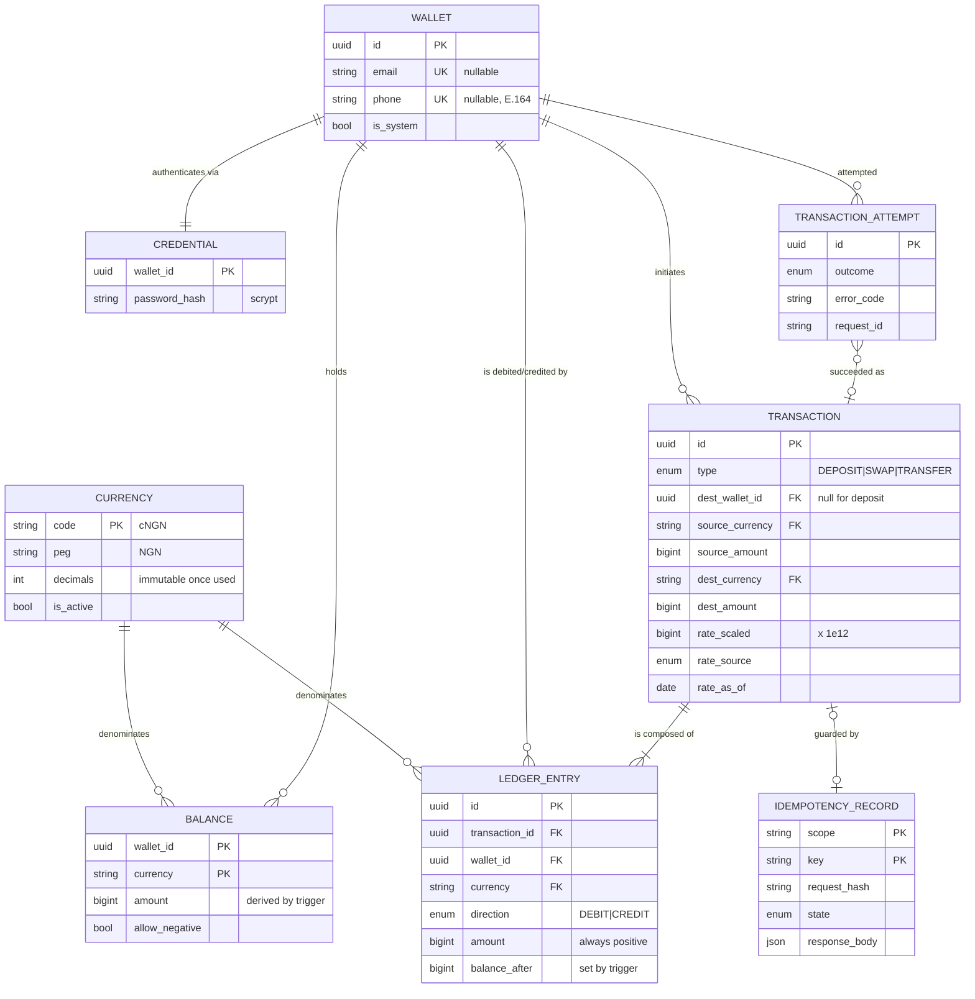

# Swipe Pay

A cross-border stablecoin payment sandbox: multi-currency wallets, simulated
deposits, cross-currency swaps, wallet-to-wallet transfers, and an auditable
transaction history. REST API, no frontend, 235 tests, TypeScript strict.

Five mock stablecoins, each pegged 1:1 to a fiat currency:

| Token | Peg | Decimals | Minor unit |
|---|---|---:|---|
| `cNGN` | NGN — Nigerian Naira | 2 | kobo |
| `cGHS` | GHS — Ghanaian Cedi | 2 | pesewa |
| `cXAF` | XAF — Central African CFA franc | **0** | franc |
| `USDx` | USD — US Dollar | 6 | micro-dollar |
| `EURx` | EUR — Euro | 6 | micro-euro |

`cXAF` has 0 decimals because the CFA franc has no subunit in circulation —
`"100.50"` cXAF is rejected, not rounded.

---

## Quick start

```bash
docker compose up --build
```

That's the whole thing. The API comes up on `http://localhost:3000`,
migrations and the currency seed run from the container's entrypoint, and
Swagger UI is at **http://localhost:3000/docs**.

Ports already taken on your machine:

```bash
POSTGRES_PORT=55432 REDIS_PORT=56380 docker compose up --build
```

### Tests

```bash
yarn test
```

No setup required — the suite starts throwaway PostgreSQL and Redis
containers via testcontainers, applies the committed migrations and seeds the
currency table. Docker must be running.

```bash
yarn test:unit   # fast, hermetic — no database, no network
yarn test:e2e    # full application over HTTP
yarn lint && yarn typecheck && yarn docs:check
```

### Without Docker

```bash
cp .env.example .env            # point DATABASE_URL / REDIS_URL at your own
yarn install
yarn prisma:deploy && yarn db:seed
yarn start:dev
```

Yarn 4 is vendored (`.yarnrc.yml`'s `yarnPath`), so any `yarn` on your PATH
delegates to the committed release.

---

## Tech stack, and why

| Area | Choice | Why |
|---|---|---|
| Runtime | Node 22 LTS | |
| Language | TypeScript, strict + `noUncheckedIndexedAccess`, `exactOptionalPropertyTypes` | |
| Framework | NestJS 12 | DI used for real for FX provider chain and token store |
| Database | **PostgreSQL 16** + Prisma | see below |
| Cache | Redis 7 | token revocation, FX rate cache |
| Tests | Jest + Supertest + testcontainers | real Postgres/Redis, no mocks below HTTP |
| Tooling | Yarn 4 (vendored), ESLint, Prettier | |

**Why PostgreSQL.** A debit and a credit must either both happen or neither
does, and concurrent debits must not overdraw a balance. That needs:

- **Row-level locking** (`SELECT … FOR UPDATE`) to make the overdraft race
  impossible .Two concurrent transfers on the same balance serialize behind
  the lock instead of both reading a stale figure. Verified by test: 20
  simultaneous swaps against a 100.00 balance → exactly 10 succeed, balance
  lands on exactly 0.00.
- **Exact integer money.** `BIGINT` minor units, no rounding behavior to
  reason about.
- **Constraints the app can't forget.** CHECK constraints and triggers make
  negative customer balances unrepresentable, not merely unintended, and make
  `balances` derived rather than writable (below).
- **Unique constraints as a concurrency primitive** for wallet-contact
  uniqueness and idempotency, instead of a read-then-write two requests could
  both pass.

MongoDB has multi-document transactions, but weaker declarative constraints
and no exact decimal type; idempotency here depends on a unique index being
transactional with the ledger write. Prisma for its migrations and generated
types — row locks go through `$queryRaw` since `FOR UPDATE` has no query-API
expression, which keeps the lock explicit.

**Why `balances` is a writable-looking table that isn't.** The obvious design
is event sourcing — balance as `SUM(ledger_entries)`, no second copy. It
wasn't chosen because the overdraft check needs something to *lock*, and a
`SUM()` can't be locked: two concurrent debits would compute the same total,
both pass, and overdraw. So `balances` stays, but the application's only
write is `INSERT INTO ledger_entries`; a trigger applies the signed delta and
derives `balance_after`, and other triggers reject any direct write to
`balances.amount`. Divergence between ledger and projection becomes
structurally impossible rather than something a test merely asserts.

---

## API walkthrough

Amounts are **decimal strings**, never JSON numbers — `JSON.parse('{"amount":0.1}')`
already holds an IEEE-754 double before any server code runs.

Every response shares one envelope:

```json
{ "requestSuccessful": true, "requestCode": 200, "requestMessage": "...", "requestData": { } }
```

`requestSuccessful` is `true` for any 2xx; `requestData` carries the payload
on success and the error specifics on failure. Branch on `errorCode` inside
`requestData`, not on `requestCode` alone — several error conditions share a
status.

### 1. Register a wallet, then log in

```bash
curl -X POST localhost:3000/v1/auth/register \
  -H 'content-type: application/json' \
  -d '{"email":"ada@example.com","password":"correct-horse-battery-staple"}'
```

```json
{
  "requestData": {
    "id": "01a186de-ebf2-776d-855a-171636dc7355",
    "email": "ada@example.com",
    "balances": [
      { "currency": "cNGN", "amount": "0.00", "usdEquivalent": "0.000000" },
      { "currency": "cXAF", "amount": "0",    "usdEquivalent": "0.000000" }
    ],
    "totalUsdEquivalent": "0.000000",
    "totalCurrency": "USDx"
  }
}
```

Email **or** mobile number (E.164); exactly one required, and neither may
already belong to another wallet. `id` is what another wallet uses as
`toWalletId`. Registration returns the wallet only — log in separately with
the same contact and password for a token pair:

```bash
curl -X POST localhost:3000/v1/auth/tokens \
  -H 'content-type: application/json' \
  -d '{"email":"ada@example.com","password":"correct-horse-battery-staple"}'
```

```json
{ "requestData": { "walletId": "01a186de-ebf2-776d-855a-171636dc7355",
  "accessToken": "eyJ...", "refreshToken": "eyJ...", "expiresIn": 900, "tokenType": "Bearer" } }
```

### 2. Deposit (simulated)

```bash
curl -X POST localhost:3000/v1/deposits \
  -H "authorization: Bearer $ACCESS_TOKEN" \
  -H 'idempotency-key: 7f9a2c54-1e3b-4d7a-9f10-2b5c8e4a6d31' \
  -d '{"currency":"cNGN","amount":"1500000.00"}'
```

```json
{ "requestData": { "type": "DEPOSIT", "sourceCurrency": "cNGN", "sourceAmount": "1500000.00",
  "rate": "1", "rateSource": "PEGGED", "createdAt": "2026-10-29T08:09:12.401Z" } }
```

### 3. Swap inside the wallet

```bash
curl -X POST localhost:3000/v1/swaps \
  -H "authorization: Bearer $ACCESS_TOKEN" \
  -H 'idempotency-key: 3b1f8e22-54c9-4a07-bd61-9e4f2a7c1d85' \
  -d '{"fromCurrency":"cNGN","toCurrency":"USDx","amount":"500000.00"}'
```

```json
{ "requestData": { "type": "SWAP", "sourceCurrency": "cNGN", "sourceAmount": "500000.00",
  "destCurrency": "USDx", "destAmount": "371.405660", "rate": "0.00074281132", "rateSource": "LIVE" } }
```

### 4. Transfer, converting on the way

```bash
curl -X POST localhost:3000/v1/transfers \
  -H "authorization: Bearer $ACCESS_TOKEN" \
  -H 'idempotency-key: 9c7d1b40-2a68-4f13-8e5a-6b0c3d9f7e12' \
  -d '{"toWalletId":"01a186df-7c10-7bb1-9a44-2f8e1c3d5a67","currency":"USDx","toCurrency":"EURx","amount":"100.000000"}'
```

```json
{ "requestData": { "type": "TRANSFER",
  "sourceWalletId": "01a186de-...", "destWalletId": "01a186df-...",
  "sourceCurrency": "USDx", "sourceAmount": "100.000000",
  "destCurrency": "EURx", "destAmount": "89.721500",
  "rate": "0.897215", "rateSource": "LIVE", "createdAt": "2026-10-29T08:11:02.118Z" } }
```

No `fromWalletId` — the sender is always the token holder. The record keeps
sender, receiver, both amounts, both currencies, the rate, and a timestamp.
That same transfer reads as `CREDIT 89.721500 EURx` in the receiver's
statement — one row, stored once, correct from both sides.

### 5. Read the statement

```bash
curl "localhost:3000/v1/transactions?type=TRANSFER&currency=USDx&limit=20" \
  -H "authorization: Bearer $ACCESS_TOKEN"
```

```json
{ "requestData": { "items": [ { "id": "01a186e1-...", "type": "TRANSFER", "direction": "DEBIT",
  "currency": "USDx", "amount": "100.000000", "balanceAfter": "271.405660",
  "counterpartyWalletId": "01a186df-...", "rate": "0.897215", "createdAt": "..." } ],
  "nextCursor": "MjAyNi0...", "hasMore": true } }
```

Filterable by `type` and `currency`, cursor-paginated, newest first.
`GET /v1/transactions/:id` fetches a single one.

### 6. Rates

```bash
curl localhost:3000/v1/rates
```

```json
{ "requestData": { "asOf": "2026-10-29T08:00:00.000Z", "source": "live", "degraded": false,
  "rates": [ { "from": "cNGN", "to": "USDx", "rate": "0.00074281132" } ] } }
```

### Endpoint list

| Method | Path | Auth | |
|---|---|---|---|
| `POST` | `/v1/auth/register` | — | register a wallet; returns the wallet, not tokens |
| `GET` | `/v1/wallets` | ✓ | balances + total in USD |
| `POST` | `/v1/deposits` | ✓ | simulated deposit |
| `POST` | `/v1/swaps` | ✓ | convert inside one wallet |
| `POST` | `/v1/transfers` | ✓ | send to another wallet, converting if needed |
| `GET` | `/v1/transactions` | ✓ | statement, newest first, cursor-paginated |
| `GET` | `/v1/transactions/:id` | ✓ | one transaction |
| `GET` | `/v1/attempts` | ✓ | attempt log, including failures |
| `POST` | `/v1/auth/tokens` | — | log in; returns a token pair |
| `POST` | `/v1/auth/tokens/refresh` | refresh | rotate |
| `DELETE` | `/v1/auth/tokens` | ✓ | log out |
| `GET` | `/v1/rates` | — | every pair, with freshness |
| `GET` | `/v1/currencies` | — | supported currencies and precision |
| `GET` | `/v1/health` | — | liveness, and whether rates are degraded |

No `walletId` ever appears in a path — the caller's wallet is resolved from
the token, so no route can be pointed at someone else's wallet.

---

## Data model



`ledger_entries` is the source of truth and append-only; `balances` is a
projection the database maintains by trigger. Querying history over entries
rather than transactions is what lets one transfer row read as *sent* for the
sender and *received* for the receiver without being stored twice, and lets a
cross-currency swap show up as two statement rows sharing one transaction id.

`transaction_attempts` holds the failures, so `transactions` only ever
contains committed money which is what keeps the per-currency net-zero
invariant provable.

**Clearing accounts.** Double-entry needs a counterparty for a movement with
no second wallet: `SYSTEM_MINT` is debited on every deposit (so issued supply
is auditable), and `SYSTEM_FX` takes the counter-leg on both sides of a
conversion, since a debit in cNGN can't net against a credit in USDx:

```
cNGN :  payer −1000.00   SYSTEM_FX +1000.00    = 0
USDx :  SYSTEM_FX −0.625  payee    +0.625      = 0
```

A same-currency movement writes 2 ledger entries; a cross-currency one writes
4. Clearing accounts legitimately carry negative positions (correct
accounting), which is why the non-negative CHECK is conditional on
`allow_negative`.

---

## Money precision, idempotency, concurrency, FX failures

**Money precision.** Every amount is a `bigint` count of minor units. No
`number`, no decimal library, on any path that touches money. Amounts cross
the API boundary as decimal strings for the same reason IEEE-754 can't
represent `0.1`. Rates are integers too, scaled by `1e12`. A conversion is one
exact rational with a single explicit rounding step, and it **floors**: the
system can never credit more value than it debited, and the discarded
fraction (always under one minor unit) accrues to `SYSTEM_FX` rather than
vanishing. `"0.005"` cNGN is rejected, not rounded to `0.01` — precision is
enforced, not assumed. `MoneyUtil` is pure integer arithmetic with 45 unit
tests, including property checks that flooring never exceeds the exact value.

**Idempotency.** The three money-moving endpoints require an
`Idempotency-Key` header. The claim is inserted with `INSERT … ON CONFLICT DO
NOTHING` **inside the operation's own database transaction** — a key claimed
in Redis or a separate transaction could outlive a rollback and poison the
operation permanently. The fingerprint is a SHA-256 of the canonicalised
(recursively key-sorted) body, so a client that re-serializes JSON on retry
still gets a replay. Deterministic 4xx failures (`INSUFFICIENT_FUNDS`, …)
consume the key and replay the stored error; transient 5xx failures
(`RATE_UNAVAILABLE`, a DB blip) release it, since a retry can legitimately
succeed. `error.retryable` publishes exactly this to clients.

**Concurrency.** One transaction per operation; every affected balance row is
taken with `SELECT … FOR UPDATE` **ordered by `(wallet_id, currency)`** before
anything is read for a decision — so two concurrent debits can't both read
the same stale balance, and two opposing transfers (A→B, B→A) can't deadlock
since both acquire rows in the same order. `READ COMMITTED` with explicit
locks rather than `SERIALIZABLE`, trading the need to catch and retry
serialization failures for a conflicting writer that simply waits.
`LedgerService` is the only writer of `ledger_entries` and `transactions`, so
the locking logic exists exactly once. Proven by test: 20 simultaneous swaps
against a 100.00 balance → exactly 10 succeed, landing on exactly 0.00; 16
opposing transfers complete with no deadlock and conserve value; six
concurrent requests on one idempotency key credit exactly once. Failed
attempts (and successes) are still recorded — in `transaction_attempts`,
written after the failed transaction rolls back on a fresh connection, since a
row inserted inside the doomed transaction would disappear with it.

**FX rate failures.** Rates degrade; they don't fail:

```
Redis cache → live provider → PostgreSQL last-known-good → committed static table
```

Every result carries `source` (`live` / `cached` / `stale` / `fallback` /
`pegged`) and `asOf`, recorded on the transaction and returned by `GET
/rates`. Same-currency movements never consult a provider, so they keep
working through a total outage. The snapshot tier lives in PostgreSQL, not
just Redis, so an outage survives a restart; a snapshot older than
`FX_SNAPSHOT_MAX_AGE_SECONDS` is refused rather than quoted as current. One
USD-based table (not N² pairs) means every cross rate is derived from two
numbers refreshed at the same instant. The provider call is bounded by an
`AbortController` — a hang is worse than a refusal. Verified against the
running stack with the provider pointed at an unreachable address: `GET
/rates` reports `stale`, a swap still succeeds recorded as `STALE`, and a
same-currency transfer completes at `PEGGED`.

---

## Error codes

Every failure uses the same envelope; branch on `errorCode` in `requestData`,
never on the HTTP status alone. Each code below has a test that produces it.

| Code | HTTP | Retryable | Cause |
|---|---:|:---:|---|
| `VALIDATION_FAILED` | 400 | no | Body/query failed DTO validation |
| `INVALID_AMOUNT` | 400 | no | Not an unsigned decimal string |
| `IDEMPOTENCY_KEY_REQUIRED` | 400 | no | Header missing on a money-moving endpoint |
| `INVALID_CURSOR` | 400 | no | Malformed pagination cursor |
| `UNAUTHENTICATED` | 401 | no | Missing or unverifiable token |
| `INVALID_CREDENTIALS` | 401 | no | Wrong password / unknown contact — same response, not an enumeration oracle |
| `TOKEN_EXPIRED` / `TOKEN_REVOKED` / `TOKEN_WRONG_TYPE` | 401 | no | Auth token lifecycle |
| `FORBIDDEN_WALLET_ACCESS` | 403 | no | Authenticated, not a party to the resource |
| `WALLET_NOT_FOUND` / `TRANSACTION_NOT_FOUND` | 404 | no | No such resource |
| `WALLET_CONTACT_TAKEN` | 409 | no | Email/phone already has a wallet |
| `IDEMPOTENCY_KEY_IN_FLIGHT` | 409 | **yes** | Same key still running |
| `IDEMPOTENCY_KEY_REUSED` | 422 | no | Same key, different body |
| `INSUFFICIENT_FUNDS` | 422 | no | `details` carries requested vs. available |
| `UNSUPPORTED_CURRENCY` | 422 | no | Not in the currency table, or deactivated |
| `AMOUNT_PRECISION_EXCEEDED` | 422 | no | More decimals than the currency admits |
| `AMOUNT_OUT_OF_RANGE` | 422 | no | Amount, or its conversion, can't be stored |
| `SAME_CURRENCY_SWAP` / `SELF_TRANSFER` | 422 | no | Wrong operation for same-currency/same-wallet |
| `AMOUNT_TOO_SMALL_TO_CONVERT` | 422 | no | Would convert to zero |
| `RATE_UNAVAILABLE` | 503 | **yes** | No tier of the FX chain could price this pair |
| `INTERNAL_ERROR` | 500 | **yes** | Unexpected; real error/stack logged against the request id |

---

## Assumptions

- Deposits are simulated — no payment rail; a deposit credits the wallet and
  debits `SYSTEM_MINT`, as the brief asks.
- One wallet per contact, one contact per wallet.
- No FX spread — users convert at the mid-market rate.
- Stablecoins are perfectly pegged.
- The rounding gain from flooring stays on `SYSTEM_FX`, auditable rather than
  redistributed.
- **Auth beyond the brief.** The brief says full authentication isn't
  required; this adds JWT + scrypt passwords + Redis-backed refresh rotation
  anyway, mainly so Redis earns its place and so no route can read another
  wallet's balance. Cost: there's no unauthenticated `GET /wallets/:id`, so a
  reviewer needs a token before seeing any data — registration
  (`POST /v1/auth/register`) returns the wallet alone, and logging in
  separately at `POST /v1/auth/tokens` is what gets a token pair.

## Known limitations

- `CurrencyRegistry` caches at boot — a currency added to the table isn't
  visible until restart.
- Compile-time exhaustiveness over currency codes is gone; validation is a
  runtime check at one chokepoint (currencies are a table, not an enum, so a
  new stablecoin is an `INSERT` not a release).
- No fees, limits, KYC or sanctions screening.
- No reversals/refunds — the ledger is append-only, so a correction would be
  a compensating entry; the model supports it, the API doesn't expose it.
- Append-only isn't tamper-proof: a one-sided entry inserted with direct
  database access would move a balance. Detectable (the per-currency net
  stops being zero) but not prevented.
- No rate limiting — the login endpoint is the obvious target.
- `GET /rates` reports one `asOf` for the whole table (all pairs derive from
  one USD fetch at the same instant) rather than a timestamp per pair.

## With more time

1. A reconciliation job asserting ledger invariants continuously, with
   alerting on drift.
2. Fees and a configurable FX spread, as their own ledger leg.
3. Rate limiting on login and the money endpoints.
4. Idempotency record expiry (they currently accumulate forever).
5. A webhook/event stream for incoming transfers — the one place a queue
   would earn its place.
6. Currency cache invalidation via Redis pub/sub.
7. Load testing to find where lock contention on a hot wallet actually bites.
8. A `GET /wallets/all` admin surface.
9. Hash-chained ledger entries, so an inserted/reordered entry breaks the
   chain rather than merely unbalancing the books.

---

## Project layout

```
src/
  money/        MoneyUtil (integer arithmetic), CurrencyRegistry
  fx/           FxService + three providers behind one interface
  auth/         JWT, scrypt passwords, Redis token store, wallet registration
  wallets/      balances, USD total
  ledger/       LedgerService — the only writer of money; clearing accounts
  transactions/ deposit / swap / transfer
  history/      statement, fetch by id, attempt log
  common/       error taxonomy, idempotency, pagination
test/           e2e suite against real Postgres and Redis (testcontainers)
prisma/         schema, migrations, currency seed
openapi.json    committed spec, CI-checked against the code
```

API docs: Swagger UI at `/docs`, spec committed at `openapi.json`
(`yarn docs:check` fails CI on drift).
